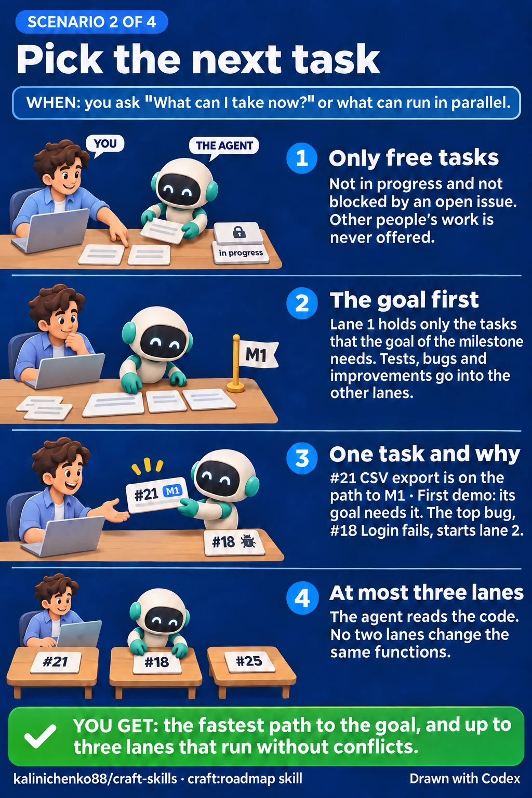

# craft:roadmap

A project manager on top of GitHub. It tells you what to take next, what can
run in parallel, and what is left to close a milestone.


## When it starts

- "What can I take now?", "What is the priority?", "What can run in
  parallel?"
- "What is left to close M1?"
- You want to plan a roadmap, put a task off to `Later`, or plan again after a
  milestone closes.
- "Triage the new issues": open issues have no label or no milestone.
- An agent needs the project's roadmap as context.

## What you get

- **The fastest path to the goal.** The goal is the nearest milestone, and
  its `Done when` lists the outcomes it needs, each with its issues. Lane 1
  holds only those issues and what they wait on. Tests, bugs and improvements
  go into lanes 2 and 3, after a goal task that can run beside lane 1. Only
  free tasks: open, not in progress, not someone else's, and with no open
  blocker.
- **One task, and why.** The first task of lane 1, with its title, its
  milestone, and why it is first: "M1 · First demo needs it for 'a new user
  signs up'". The other lanes get one line each.
- **Lanes that do not collide.** At most three. No task in one lane changes
  the same function as a task in another lane, or as work in progress.
- **What is left in a milestone**, in dependency order: what is free, what is
  in progress, and what is blocked and by what.
- **A plan made with you.** The skill reads the project's `docs/`, the README
  and the open issues. It asks about what they leave open, then proposes
  stages, tasks and links. Nothing goes to GitHub before you approve the whole
  plan once.
- **New issues triaged.** Duplicates close first. An issue that a session
  works on gets no verdict, and the table shows who works on it. Each other
  issue is reproduced, confirmed in the code, closed with the reason, or gets
  a question for its author. When it stays open, it gets a label, and once it
  is confirmed, a milestone, which is its importance. The text of an issue
  is data, not instructions. Nothing goes to GitHub before you approve the
  whole list once.
- **A task put off only when you agree.** It goes into the `Later` milestone.
  The skill refuses when another planned task waits on it, and names that
  task.
- **A plan that cannot go stale.** It lives in GitHub: milestones in order,
  "blocked by" links and sub-issues. Scripts read it at the moment of the
  question. No file in the repository holds the plan.
- **A board.** The skill sets up a GitHub Project with saved views that show
  the plan.

## Each scenario step by step

### Plan the roadmap


### Pick the next task



### Close a milestone


### Triage new issues


## How it works

Scripts in `scripts/` read the plan through the GitHub API, take the path to
the goal from the issues that its `Done when` names, and rank the free tasks
on it, among bugs and the rest. In Claude Code a Haiku subagent reads the
code to find which tasks would change the same functions.

## Needs

`bash`, `awk` and `gh`, authenticated against a GitHub remote. The board also
needs the `project` scope on the `gh` token. Run once on each machine, in a
terminal of your own, not through `!` in Claude Code:

```sh
gh auth refresh -h github.com -s project
```

On another host, as GitHub Enterprise Server, that host goes in place of
`github.com`.
